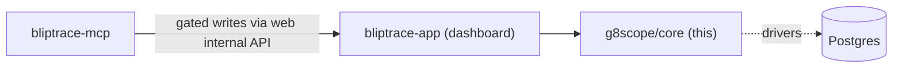

# g8scope/core — Architecture

> Derived from the platform specification §5 (web app + core) and §18 (contracts & seams). The
> platform spec is the source of truth; this is the component-scoped view. The architecture is
> **locked** — do not redesign.

## Why this package exists

g8scope has two surfaces that mutate domain state: the **web dashboard** (`bliptrace-app`) and the
**MCP** (`bliptrace-mcp`, P2 gated writes). If each implemented mutations itself, they would drift —
different audit, different scrub, different rules. So **all** Laravel-side domain logic lives here,
once, and both surfaces use it:

The MCP never writes the DB directly; it delegates to the web app, which executes through core.
Single source of truth for mutations + audit + PII scrub.

## What lives here (spec §17, §18)

- **Enums** with `label()`/`color()`: `IssueStatus`, `Level`, `Environment`, `ProjectRole`,
  `EndpointType`, `ReportType`, `SupportStatus`.
- **`HasDualKey`** trait: UUID public / bigint internal, route-binds on `uuid`.
- **Driver contracts** (seams), each bound to a concrete driver by the app (stub in tests):
  `Fingerprinter` + `Normalizer`, `Scrubber`, `IssueStore` (PG), `OccurrenceStore` (CH),
  `EndpointResolver`, `EntitlementGate`, `SupportProvider`, `ReportGenerator`, `Notifier`.
- (Feature work) **Actions** — `RequestSupport`, `SwitchEndpoint`, `InviteMember`, `GenerateReport`;
  **Observer** — Project created → provision default endpoint + ingest key; **audit log**.

## Storage split (spec §8)

| Concern | Store | Direction here |
|---|---|---|
| Accounts, projects, members, ingest keys, **issues**, entitlements, alert rules, reports | PostgreSQL | read + write |
| **Occurrences**, sparklines, counts-over-time | PostgreSQL (`occurrences`, partitioned monthly by `occurred_at`) | read (+ write for app/tests); the Go ingest API writes in production. Retention drops whole partitions daily (`g8scope:occurrences:maintain`) |

## Driver binding

`config/g8scope.php` maps each contract to a concrete class. The web app binds production drivers in
its service provider; tests bind array/stub drivers. This is the "driver-based abstractions
everywhere" rule (spec §17) and what makes the domain testable without real PG/CH.

## Boundary with bliptrace-contracts

The **envelope shape** is owned by `bliptrace-contracts` (versioned JSON Schema). Envelope DTOs used
here derive from that pinned schema; the envelope is never redefined in this package.
